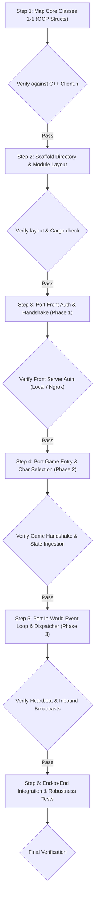

# GoonZu Client (Rust Port) — 1-1 OOP Architecture

Native Rust port of the GoonZu World client, maintaining a strict 1-to-1 object-oriented structural parity with the original C++ codebase (`GoonZu_Source/GoonZuWorld/Client`). Designed to interface against the Rust game server stack (`rust_Iwcgz_server`).

---

## 🛡️ Core Governance Rules

1. **Verification-First Rule (Strict Enforcement)**
   - Every single step must be explicitly verified and validated against the original C++ source (`GoonZu_Source`) and the wire truth of the server (`rust_Iwcgz_server`).
   - Run live tests against the target endpoints (`127.0.0.1` or ngrok tunnel) before marking any step as completed. Never assume or skip verification.

2. **Dynamic Sub-steps Policy**
   - The master plan may branch into finer sub-steps (`Step X.1`, `Step X.2`, etc.) whenever practical engineering nuances arise.
   - Keep each step atomic, simple, and self-contained to avoid confusion and prevent over-engineering.

3. **Incident RCA & Full Report Protocol**
   - If a compile failure, protocol mismatch, panic, or unexpected disconnect occurs, immediately halt execution.
   - Perform a formal **Root Cause Analysis (RCA)** and create a full report under `docs/rca/` detailing:
     - **Summary**: What broke, when, and under which step.
     - **Root Cause**: The exact physical reason (memory offset, endianness, wire framing, state mismatch).
     - **Evidence**: Hex dumps, stack traces, compiler output.
     - **Resolution**: The minimal, surgical fix.
     - **Prevention**: What verification check prevents regression.

4. **Document Control Policy (No Hidden Files)**
   - All documentation, architectural blueprints, runbooks, and RCA reports must live in visible, standardized top-level directories (e.g. root `README.md`, `docs/`, `docs/rca/`).
   - Do not hide or scatter critical documentation inside deeply nested code folders.

---

## 🗺️ Master Migration Plan (1-1 OOP Style)

---

### **Step 1: Core Class Mapping (1-1 Struct Definition)**
- Map core C++ classes to idiomatic Rust structs while preserving responsibilities and memory layout semantics:
  1. `cltClient` (`Client.h` / `Client.cpp`): Top-level client coordinator and state holder.
  2. `cltStateBox` (`Network/StateBox.h`): Connection and lifecycle state machine.
  3. `cltWorldList` & `WORLDINFO` (`WorldList.h`): Server list cache and endpoint descriptors.
  4. `ITZNetOverlapped` / `ITZSession` (`NetworkLib/ITZNetLib`): Socket transport, framing, and cipher contexts.
  5. `cltCharClient` (`Char/CharClient/Char-Client.h`): Active character data, coordinates, and stats.
- **Verification Gate**:
  - Compare every field and enum against C++ `.h` definitions line-by-line.

---

### **Step 2: Project Layout & Module Scaffolding**
- Mirror C++ sub-directory structure inside `src/`:
  - `src/client/`: `clt_client.rs`, `state_box.rs`, `client_login.rs`
  - `src/network/`: `net_session.rs`
  - `src/world/`: `world_list.rs`
  - `src/char/`: `char_client.rs`
  - `src/config.rs`: Endpoints configuration (`127.0.0.1` vs `ngrok` tunnels)
- **Verification Gate**:
  - Run `cargo check` / `cargo build` to guarantee clean compilation with zero warnings/errors.

---

### **Step 3: Front Server Handshake & Authentication (Phase 1)**
- Source reference: `Client-Login.cpp`
  1. Connect to Front service (`127.0.0.1:5700` or `0.tcp.ap.ngrok.io:11853`).
  2. Receive `RESPONSE_SECRETKEY` (30000) $\to$ initialize cipher stream.
  3. Send `REQUEST_ENGLISH_LOGIN` (21) $\to$ receive `RESPONSE_LOGIN` (1000).
  4. Send `REQUEST_WORLDLIST` (3) $\to$ receive `RESPONSE_WORLDLIST` (1002) and populate `cltWorldList`.
  5. Terminate Front session cleanly to transition to Game server.
- **Verification Gate**:
  - Live socket exchange test against running server. Validate world list contents against server database.

---

### **Step 4: Game Server Handshake, Character Selection & Entry (Phase 2)**
- Source reference: `Client-Login.cpp` & `Client-ServerReturn.cpp`
  1. Connect to Game service (`127.0.0.1:4010` or `0.tcp.ap.ngrok.io:27911`).
  2. Receive link key from `RESPONSE_CLIENTCHARUNIQUE` (1).
  3. Send `REQUEST_LOGIN` (2).
  4. Receive all `RESPONSE_CHARLIST` (3) frames for existing slots.
  5. Send `REQUEST_SELECTCHAR` (4) for targeted slot.
  6. Receive `RESPONSE_SERVERINFO` (106) and `RESPONSE_LOGIN` (5) $\to$ populate `cltCharClient`.
  7. Send `REQUEST_VILLAGESTRUCT` (1101) $\to$ transition `cltStateBox` to `InWorld`.
- **Verification Gate**:
  - Assert that player stats (Level, HP, MP, coordinates) match wire payload exactly.

---

### **Step 5: In-World Event Loop & Message Dispatcher (Phase 3)**
- Autonomous asynchronous game loop:
  1. **Heartbeat**: Dispatch `REQUEST_HEARTBEAT` (100) on a 10-second ticker.
  2. **Message Dispatcher**: Non-blocking packet router:
     - Chat messages (`118`)
     - Nearby entities/players (`6`, `11`)
     - Character/monster state sync (`200`)
     - HP/MP adjustments (`215`)
  3. Dynamically reflect incoming delta packets into `cltCharClient`.
- **Verification Gate**:
  - Maintain active game session for $\ge 2$ minutes without disconnect, verifying heartbeat and inbound broadcasts.

---

### **Step 6: End-to-End Integration Testing**
- Full automated connection flow verification across two modes:
  - **Local Mode**: `127.0.0.1:5700` (Front) / `127.0.0.1:4010` (Game)
  - **Ngrok Mode**: `0.tcp.ap.ngrok.io:11853` (Front) / `0.tcp.ap.ngrok.io:27911` (Game)
- **Verification Gate**:
  - Clean state transitions from boot to teardown without panics or protocol desynchronization.

---

## 🛠️ Testing Endpoints Reference

| Service | Local Endpoint | Remote (Ngrok) Endpoint |
|---|---|---|
| **Front Server** | `127.0.0.1:5700` | `tcp://0.tcp.ap.ngrok.io:11853` |
| **Game Server** | `127.0.0.1:4010` | `tcp://0.tcp.ap.ngrok.io:27911` |
