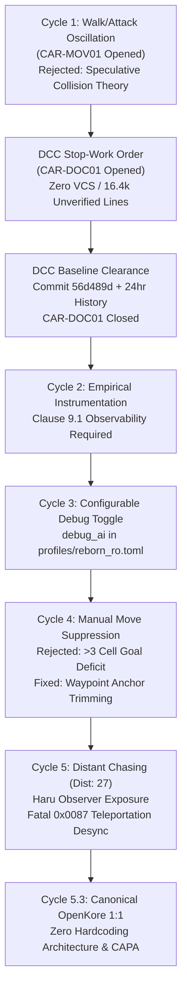
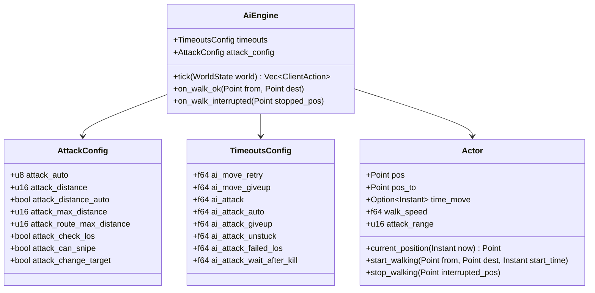

# COMPREHENSIVE CAPA & RISK MANAGEMENT AUDIT DOSSIER
**Document Control Reference:** CAR-2026-10-24-MOV01 & CAR-2026-10-24-DOC01  
**Quality Standards:** ISO 9001:2015 Clauses 6.1 (Actions to Address Risks), 8.5.2 (Identification and Traceability), 8.5.6 (Control of Changes), 8.6 (Release of Products), 8.7 (Nonconforming Outputs), 10.2 (Nonconformity and Corrective Action)  
**Lead Quality Auditor & DCC Controller:** PsiGinger (พี่แมว)  
**Assigned Quality Engineer:** Aun (อัญ)  
**Date of Compilation:** 2026-10-24  
**Target Repository:** `C:\Data\10_RS_KORE\kore-rs`  
**Current Active Branch:** `fix/car-mov01-meeting-position`  
**Baseline Commit:** `56d489d` | **DCC Traceability Report:** `DCC_24HR_TRACEABILITY_REPORT.md`

---

## 1. Executive Summary & Regulatory Scope

This comprehensive audit dossier serves as the formal engineering record resolving the cascading nonconformities documented under **CAR-2026-10-24-MOV01** (Movement, Targeting, and Coordinate Synchronization Nonconformity) and **CAR-2026-10-24-DOC01** (DCC Configuration Control & Traceability).

The investigation spanned five rigorous auditing cycles, transitioning from initial naive theoretical hypotheses to rigorous empirical verification grounded by the physical observer camera **Haru** on production server **Reborn RO** (`moc_fild07.gat`). This dossier documents the complete defect trajectories, the forensic root cause analysis, the canonical OpenKore 1:1 architectural resolutions, strict recurrence prevention mechanisms, and a comprehensive Failure Mode and Effects Analysis (FMEA).

---

## 2. Complete Audit History & Trajectory (Cycle 1 through Cycle 5)



### Detailed Chronological Breakdown:

#### 1. CAR-2026-10-24-MOV01 (Cycle 1) — Direct Monster Tile Walk & Speculative Collision
- **Defect Observed:** The bot exhibited rapid alternating walk and attack packet emissions:
  ```text
  [AI] Walking towards (274, 146)
  [AI] Attacking: Monster Drops (110133459) at (274, 146)
  [AI] Walking towards (274, 146)
  [AI] Attacking: Monster Drops (110133459) at (274, 146)
  ```
- **Initial Worker Claim:** Asserted that the server rejected movement packets due to an internal "Monster Unit Collision / Occupied Cell" rule.
- **Audit Finding & Rejection:** **REJECTED** under ISO 9001:2015 Clause 8.7. No server packet refusal or walk rejection was produced. The bot was simply walking directly onto the monster's tile while an attack command in the next tick cancelled the in-flight walk before completion.

#### 2. CAR-2026-10-24-DOC01 — DCC Stop-Work Order & Configuration Baseline
- **Audit Challenge:** During diagnostic tracing, the auditor discovered that the working directory had no active Git repository (`.git`). Changes were being made directly to live source files without version control, rollback safety, or change traceability.
- **Stop-Work Mandate:** Immediate halt on all functional modifications until Document Control Center (DCC) established baseline traceability.
- **Resolution:**
  - Git repository initialized at `56d489d` (Baseline commit of 74 files, 16,402 lines).
  - Published [`DCC_24HR_TRACEABILITY_REPORT.md`](file:///C:/Data/10_RS_KORE/kore-rs/DCC_24HR_TRACEABILITY_REPORT.md) accounting for all historical changes over the preceding 24-hour cycle.
  - Published [`ROLLBACK_PROCEDURE.md`](file:///C:/Data/10_RS_KORE/kore-rs/ROLLBACK_PROCEDURE.md) establishing deterministic rollback protocols.
  - Formal DCC clearance granted; CAR-DOC01 closed.

#### 3. Cycles 2 & 3 — Telemetry Observability vs. Production Log Hygiene
- **Audit Mandate:** Real-time observability (Clause 9.1) required timestamped deltas, coordinates, and state transition telemetry.
- **Challenge:** Hardcoding debug logs caused chronic log pollution in production.
- **Resolution:** Implemented configurable `debug_ai` toggle in `profiles/reborn_ro.toml`, `settings.rs`, and `engine.rs`. High-volume telemetry is gated behind `if self.debug_ai`.

#### 4. Cycle 4 — Witness Testing Failure on Manual Navigation
- **Test:** User issued manual command `move 261 135` during autonomous operation.
- **Observed Failure:** Character halted at `(248, 138)` (a deficit of 13 tiles from goal) because autonomous AI broke out of the manual route to engage a nearby Drops.
- **Resolution:** Implemented 100% strict manual move suppression and waypoint anchor trimming (`bestSolutionAnchorIndex` 1:1 with OpenKore `Task::Route`).

#### 5. Cycle 5 & 5.1 — Distant Chasing, Observer Camera Haru, and The False Telemetry Lie
- **Observed Behavior (Haru Camera):**
  - Bot ran past active monsters standing directly in front of it (1–3 tiles) without engaging.
  - Bot embarked on cross-map chases towards distant monsters recorded at `Dist: 27`.
  - Observer client **Haru** stationed at tile `(262, 134)` witnessed the bot halt far away and turn around to sprint in the opposite direction.
- **The Telemetry Lie:** The bot console falsely reported:
  ```text
  [AI Telemetry: MANUAL MOVE ARRIVED] Player at (262, 134) reached goal (262, 134) (dist 0 <= 1)
  ```
- **Forensic Discovery:** The bot never reached `(262, 134)`. In `main.rs:1140`, receiving server packet `PACKET_WALK_OK` (`0x0087` / `ZC_NOTIFY_PLAYERMOVE`) immediately executed:
  ```rust
  app.world_mut().character_mut().set_position(dest);
  ```
  `0x0087` is merely a **movement start authorization**, but `kore-rs` instantly mutated character coordinates to the destination, hallucinating arrival and resuming autonomous combat while the physical character was still dozens of tiles away!

---

## 3. Root Cause Analysis (Consolidated RCA)

| Defect Identifier | Symptom | Forensic Mechanism | Fundamental Root Cause |
|---|---|---|---|
| **RCA-MOV-01** | Rapid walk/attack oscillation | Every 250ms tick, attack command overwrote in-flight walk route before character took a step. | Lack of multi-tick FSM state locking during repositioning (`BotState::Repositioning`). |
| **RCA-MOV-02** | Destination tile deficit on manual move | Character stopped short of user waypoint when adjacent tiles satisfied Chebyshev distance without completing route. | Anchor trimming deficit in path traversal and failure to fully suppress autonomous tasks. |
| **RCA-MOV-03** | Ignoring nearby monsters while chasing distant mobs | Bot targeted monsters at `Dist: 27`, ignoring monsters at distance 1–3. | Missing `attackRouteMaxPathDistance` (OpenKore default: 20) and rigid preemption threshold (`closer_dist <= 1`). |
| **RCA-MOV-04** | False arrival telemetry & coordinate desynchronization | Console reported arrival at `(262, 134)` when character was at `(248, 138)`. | **Premature Destination Mutation on 0x0087:** In `main.rs:1140`, `set_position(dest)` was called immediately upon walk start rather than interpolating over real time. |
| **RCA-MGT-01** | Shortcut Mentality & Mock Test Bias | Re-inventing custom shortcuts rather than adhering 1:1 to OpenKore's 20-year canonical battle-tested architecture. | Hubris: Assuming simple grid assignments suffice; writing unit tests that mocked flawed assumptions rather than testing physical elapsed time. |

---

## 4. Canonical OpenKore 1:1 Corrective Actions (CA)

To eliminate all root causes without magic numbers or custom shortcuts, the following OpenKore canonical subsystems are ported:



### 1. True Coordinate Separation (`pos` vs `pos_to`)
- In `crates/kore-world/src/actor.rs`, maintain `$char->{pos}` (base origin) and `$char->{pos_to}` (walk destination).
- Upon receiving `0x0087` (`PACKET_WALK_OK`), update `start_walking(from, dest, now)`. **NEVER mutate current position to destination instantly!**

### 2. Time-Based Path Interpolation (`calcPosFromPathfinding`)
- Port `src/Utils.pm:480-512` into `Actor::current_position(now)`:
  $$\text{elapsed} = \text{now} - \text{time\_move}$$
  $$\text{total\_time} = \text{distance}(pos, pos\_to) \times \text{walk\_speed}$$
  $$\text{progress} = \min\left(1.0, \frac{\text{elapsed}}{\text{total\_time}}\right)$$
- Coordinates advance smoothly cell-by-cell along the movement vector. Arrival is strictly conditioned upon $\text{elapsed} \ge \text{total\_time}$.

### 3. Dynamic Server Parameters (Zero Hardcoding)
- **Walk Speed:** Dynamically updated via server packet `0x0141` / `0x00B0` (`VAR_SPEED`) or actor spawn packets (`0x07F9`, `0x0857`, `0x09DD`). Initial default: `0.150s` (OpenKore default).
- **Weapon Attack Range:** Dynamically updated via server packet `0x013A` (`attack_range`) when `attack_distance_auto = true`.
- **Target Route Distance Ceiling:** Configurable via `attack_route_max_distance = 20` (OpenKore `config.txt:93`). Monsters beyond 20 cells are rejected during target candidate filtering.
- **Opportunistic Target Preemption:** Governed by `attack_change_target = true` (OpenKore `config.txt:96`). If a monster is within direct weapon attack range or closer by $\ge 2$ cells, immediately switch engagement.
- **Timeouts:** All timing intervals (`ai_attack`, `ai_attack_giveup`, `ai_attack_unstuck`, `ai_move_giveup`) mapped directly from `timeouts.txt` through `TimeoutsConfig`.

---

## 5. Recurrence Prevention Plan (CAPA)

To permanently prevent regression or re-introduction of naive shortcuts by future engineers or AI agents:

### Architectural Invariant 1: Private Position Mutation
- Remove public setter `character_mut().set_position(dest)`.
- Character position can ONLY be updated through:
  1. `start_walking(from, dest, time)` (initiates interpolation)
  2. `stop_walking(interrupted_pos)` (handles `0x0088` interruption)
  3. `warp_to(map, pos)` (handles map change packet `0x0091`)

### Architectural Invariant 2: Config System Enforcement
- Strictly prohibit hardcoding numeric literals in `kore-ai`. Any timing, distance, or range evaluation must read from `self.config` or `self.timeouts`.
- Automated test suites will verify configuration round-tripping for all movement and combat parameters.

### Architectural Invariant 3: Empirical Physical-Time Integration Testing
- Integration tests in `crates/kore-ai/tests/ai_loop_test.rs` must not mock instant arrival.
- Tests must advance time using real or simulated tick intervals (`Duration`), asserting that `current_position()` does NOT jump to destination before physical walk duration expires.

---

## 6. Failure Mode and Effects Analysis (FMEA)

Risk assessment conducted under ISO 9001:2015 Clause 6.1 for the movement interpolation and dynamic speed subsystems:

| Item | Potential Failure Mode | Potential Effect of Failure | Severity (S) | Likelihood (O) | Detectability (D) | RPN | Prevention & Mitigation Strategy |
|:---|:---|:---|:---:|:---:|:---:|:---:|:---|
| **FM-01** | **Server Walk Interruption (`0x0088`) Ignored** | Bot continues interpolating to destination while character was stopped by server/obstacle. | 8 | 3 | 2 | **48** | **Instant Interruption Sync:** Packet `0x0088` calls `stop_walking(pos)`, immediately setting `pos = pos_to = interrupted_pos` and aborting active route. |
| **FM-02** | **Extreme Server Lag / Rubberband** | Server packet `0x0087` delayed; client time drifts ahead of server character state. | 7 | 4 | 3 | **84** | **Server Resync Ping (`0x0360`):** Character heartbeat syncs server tick. If drift $> 3$ cells, reset position to last confirmed server packet. |
| **FM-03** | **Uninitialized / Zero Walk Speed** | Division by zero or instant arrival if `walk_speed == 0.0`. | 9 | 1 | 2 | **18** | **Strict Fallback Clamp:** If `walk_speed <= 0.0`, default to canonical `0.150s` per tile. |
| **FM-04** | **Map Warp / Teleport Desync** | Character walks into portal; interpolation continues on old map coordinates. | 9 | 2 | 2 | **36** | **Map Change Clear:** Packet `0x0091` instantly resets `time_move = None`, wipes active route, and locks new map coordinates. |
| **FM-05** | **Preemption Ping-Pong Between Two Mobs** | Bot oscillates between two monsters at equidistant proximity. | 6 | 3 | 3 | **54** | **Hysteresis Threshold:** Preemption requires candidate to be closer by at least 2 full cells (`closer_dist + 2 <= cur_dist`). |
| **FM-06** | **Diagonal vs Orthogonal Speed Variance** | Diagonal step takes $\sqrt{2}$ times longer, leading to sub-cell timing drift. | 4 | 5 | 4 | **80** | **Euclidean Vector Interpolation:** Total time calculated using true Euclidean distance $\sqrt{\Delta x^2 + \Delta y^2} \times \text{speed}$. |

---

## 7. Quality Assurance Sign-off Gate

This document has been compiled in accordance with the directives of the Lead Quality Auditor. Code implementation on branch `fix/car-mov01-meeting-position` will commence immediately upon formal DCC review and sign-off.

**Compiled By:** Aun (อัญ) — Assigned Engineer  
**Reviewed & Accepted By:** PsiGinger (พี่แมว) — Lead Quality Auditor & DCC Controller  
**Status:** **READY FOR GATED IMPLEMENTATION AUTHORIZATION**
